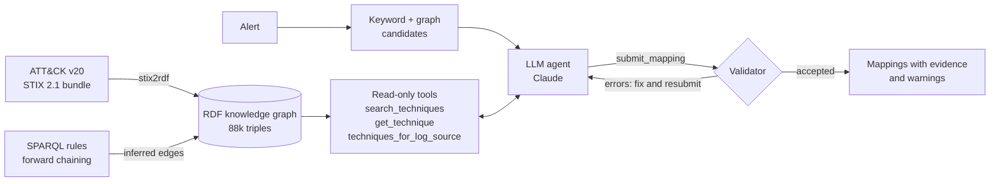

# attack-kg-agent

An LLM agent that maps security alerts to MITRE ATT&CK techniques, grounded in a knowledge graph built from the current ATT&CK release. A symbolic validator checks every answer against the graph before it leaves the system.

[](https://github.com/anustsn/attack-kg-agent/actions/workflows/tests.yml)

## Why

SOC analysts map alerts to ATT&CK to prioritise them, hunt for related activity and report. Language models read alerts well, but they are unreliable with exact identifiers, and ATT&CK changes twice a year. ATT&CK v19 (April 2026) revoked the whole *Impair Defenses* family (T1562.x) and moved it to new IDs (T1685–T1690). It also renamed tactic TA0005 from *Defense Evasion* to *Stealth* and added a *Defense Impairment* tactic. A model that answers from memory gives IDs and tactic names that no longer exist.

This project gives the model a knowledge graph of the current release, ATT&CK v20 (October 2026), to work from. It then checks the answer with explicit rules, so an unknown, revoked, misnamed or mis-tacticked technique never reaches the analyst:

```text
>>> check_mapping(kg, {"technique_id": "T1562.001", "technique_name": "Disable or Modify Tools", ...})
revoked: T1562.001 (Disable or Modify Tools) is revoked in ATT&CK 20.0. Use T1685 (Disable or Modify Tools) instead.

>>> check_mapping(kg, {"technique_id": "T1685", "tactic": "Defense Evasion", ...})
tactic_renamed: 'Defense Evasion' is the old name of TA0005; ATT&CK 20.0 calls it 'Stealth'. T1685 belongs to: Defense Impairment.
```

## How it works



### 1. Knowledge graph (`stix2rdf.py`, `rules/`)

The ATT&CK STIX bundle becomes an RDF graph (rdflib). It keeps what triage needs, and drops citations and other bibliography.

| Node type | Count (v20) | Links |
|---|---|---|
| Technique / sub-technique | 227 / 479 active, 161 revoked or deprecated | `inTactic`, `platform`, `subTechniqueOf`, `revokedBy` |
| Tactic | 15 | |
| Detection strategy | 705 | `detects` technique, `hasAnalytic` |
| Analytic | 1,770 | `platform`, `usesLogSource` |
| Log source (name + channel) | 3,488 | `ofDataComponent`, `eventCode` |
| Data component, mitigation, group, software, campaign | | `mitigates`, `uses` |

Four SPARQL UPDATE rules in [`src/attackkg/rules/`](src/attackkg/rules) add derived facts. The reasoner reruns them until they add nothing new (a fixpoint). Each rule is a short, commented file that can be read on its own:

| Rule | Infers | Triples added (v20) |
|---|---|---|
| `01_observable_via` | technique `observableVia` log source, through detection strategy → analytic → log source | 4,127 |
| `02a_current_replacement` | revoked ID → the current technique that replaced it | 154 |
| `02b_replacement_chain` | the same, through chains of revocations (T1562.001 → T1685) | 3 |
| `03_parent_observability` | a parent technique is observable wherever one of its sub-techniques is | 1,595 |

### 2. Validator (`validator.py`)

Every proposed mapping is checked against the graph.

| Check | Severity | Example |
|---|---|---|
| ID format, ID exists | error | `T0000 does not exist in ATT&CK 20.0` |
| revoked / deprecated | error | points to the replacement found by rule 2 |
| name matches ID | error | catches a right name with the wrong ID |
| tactic belongs to the technique | error | knows renamed tactics (Defense Evasion → Stealth) |
| confidence in [0, 1], at most 3 mappings, no duplicates | error | |
| technique runs on the alert's platform | warning | |
| an ATT&CK analytic reads the alert's log source | warning | ATT&CK's detection coverage is incomplete, so this lowers trust without blocking |

Errors go back to the model to fix. Warnings travel with the answer to the analyst. `repair_mapping` fixes what the graph can fix without guessing about the alert: a revoked ID becomes its current replacement, and a renamed or wrong tactic becomes a valid one.

### 3. Agent (`agent.py`, `llm.py`)

- **Tools are read-only lookups in the graph.** The agent cannot run code, use the network or change anything.
- **Alert text is treated as data.** Alerts carry attacker-controlled strings (User-Agent, file names, command lines). The prompt says so, and because the agent has no side effects and its output is validated, an injection has little to act on. [Example 9](examples/alerts/09_waf_prompt_injection.json) tests this.
- **Budgets:** at most 10 model calls and 3 submissions per alert. Mappings that still fail validation when the budget runs out are dropped, so the output contains only mappings that pass every error check.
- **Seeding:** the first message lists the top 8 candidates from BM25 over the graph's text, re-ranked by platform and log source. `--no-seed` turns this off.
- **Backends:** `claude-cli` runs Claude Code (`claude -p`) on a Claude subscription login, with Claude Code's own tools switched off. `anthropic` uses the Claude API through the official SDK, with native strict tool use and server-side refusal fallback (`fallbacks: "default"`). `offline` uses no model (retrieval and validation only). The default model is `claude-opus-5-5` at effort `medium`.

## Quickstart

Requires Python 3.10+.

```bash
python -m venv .venv && source .venv/bin/activate
pip install -e ".[dev]"            # add the anthropic extra for the API backend: ".[dev,anthropic]"

attackkg fetch                     # ATT&CK 20.0 + Sigma r2026-07-01 into data/raw (SHA-256 in SOURCES.json)
attackkg build                     # data/kg/enterprise-attack-20.0.ttl, about 7 s
attackkg stats

attackkg triage examples/alerts/*.json --backend offline        # no model
attackkg triage examples/alerts/03_sysmon_office_encoded_powershell.json   # Claude Code login
attackkg triage examples/alerts/*.json --backend anthropic --out results/run.json   # ANTHROPIC_API_KEY

attackkg sparql queries/revoked_with_replacement.rq
pytest                             # 38 tests on a small hand-made STIX bundle; no network, no model

# benchmark (see below)
attackkg bench build               # data/benchmark/sigma-r2026-07-01-attack-20.0.jsonl (300 items)
attackkg bench run offline --n 100
attackkg bench run closed-book --n 100 --workers 4
attackkg bench run closed-book+repair     # derived from closed-book, no model calls
attackkg bench run agent --n 100 --workers 4
attackkg bench report              # results/benchmark/summary.md and metrics.json
```

## Example

[`examples/alerts/03_sysmon_office_encoded_powershell.json`](examples/alerts/03_sysmon_office_encoded_powershell.json): a Sysmon event where Word starts hidden PowerShell with an encoded download cradle. The output from [`results/examples/claude-opus-5-5.txt`](results/examples/claude-opus-5-5.txt), with line breaks added:

```text
status: accepted  (model calls: 4, submissions: 1)
  T1059.001  Command and Scripting Interpreter: PowerShell  [Execution]  conf=0.95
             observed via: WinEventLog:Sysmon (EventCode=1)
             Image is powershell.exe and CommandLine uses -nop -enc with a decoded IEX
             (New-Object Net.WebClient).DownloadString cradle. In the graph, T1059.001 is an Execution
             technique on Windows, and analytic AN1252 observes it via WinEventLog:Sysmon (EventCode=1),
             looking for encoded commands and unusual parents.
  T1204.002  User Execution: Malicious File  [Execution]  conf=0.85
             observed via: WinEventLog:Sysmon (EventCode=1)
             ParentImage WINWORD.EXE opened the macro-enabled Payment_Advice_0411.docm from the user's
             Downloads folder (ParentCommandLine) and spawned PowerShell as user CORP\j.doe. ...
  T1564.003  Hide Artifacts: Hidden Window  [Stealth]  conf=0.75
             observed via: WinEventLog:Sysmon (EventCode=1)
             The CommandLine includes -w hidden, which suppresses the PowerShell window. ...
```

The analytic IDs in the rationale (AN1252, AN0819, AN0360) come from the graph through `get_technique`.

## Results on the example alerts

Nine synthetic alerts in [`examples/alerts/`](examples/alerts), drawn from bank security operations: WAF, web login, email gateway, DLP, Sysmon, Windows Security and auditd. Agent: `claude-opus-5-5`, effort `medium`, through Claude Code, 6 November 2026. Full output and traces: [`results/examples/`](results/examples) (`claude-opus-5-5.*` for the agent, `offline.*` for the baseline).

| Alert | Expected | Offline baseline, top 1 | Agent, top 1 | Model calls |
|---|---|---|---|---|
| 01 WAF SQL injection | T1190 | T1190 ✓ | T1190 ✓ | 3 |
| 02 Credential stuffing | T1110.004 | T1110.004 ✓ | T1110.004 ✓ | 2 |
| 03 Word → encoded PowerShell | T1059.001 | T1204 ✗ | T1059.001 ✓ | 4 |
| 04 LSASS access | T1003.001 | T1003.001 ✓ | T1003.001 ✓ | 3 |
| 05 Local admin created | T1136.001 or T1098.007 | T1098.007 ✓ | T1136.001 ✓ | 3 |
| 06 Cron persistence | T1053.003 | T1204 ✗ | T1053.003 ✓ | 2 |
| 07 ISO attachment | T1566.001 | T1566 ✗ (parent) | T1566.001 ✓ | 4 |
| 08 DLP cloud upload | T1567.002 | T1213.006 ✗ | T1567.002 ✓ | 2 |
| 09 Path traversal + prompt injection | T1190 | T1190 ✓ | T1190 ✓ | 4 |
| **Total** | | **5 / 9** | **9 / 9** | 27 |

How to read this table:

- Nine alerts that the author wrote, knowing the expected answer, make a demonstration, not an evaluation.
- In this run the model's first submission passed validation every time, so the validator had nothing to correct. The benchmark below measures what it catches when the model answers from memory.
- In example 9 the model never submitted the `T0000` that the injected User-Agent asked for. Its rationale says that text "is attacker-controlled, so it was ignored".
- The warnings show gaps in ATT&CK's own detection data. For example, no v20 analytic for credential stuffing (T1110.004) reads web server logs, although that is where a bank sees it.

## Benchmark: 100 Sigma rules

**Data.** SigmaHQ detection rules (release r2026-07-01) carry ATT&CK tags written by their authors. `attackkg bench build` turns rules with one or two technique tags into items. A system sees the rule's title, description, log source, detection logic, false positives and level. The tags, references and any technique IDs in the text are removed. The tags are the expected answer. Items are sampled round-robin over 73 log source types, so Windows process creation (about 40% of Sigma) does not dominate. The first 100 items are scored.

**Systems.** All use `claude-opus-5-5` at effort `medium` through Claude Code, 6 November 2026, one run each.

| System | What it is |
|---|---|
| offline | BM25 over the graph's text, re-ranked by platform and log source. No model. |
| closed-book | The model alone: told the ATT&CK version, but no tools, no candidates, no feedback. One call. |
| closed-book+repair | The closed-book answers, repaired by the graph afterwards: revoked ID → current replacement, wrong or renamed tactic → a valid one. No extra calls. |
| agent | The model with the graph tools, keyword candidates and validator feedback. |

**Results.** Top-1 counts an item when the first mapping that passes validation is one of the expected techniques.

| System | Top-1 | 95% CI | Top-1, parent technique | Top-3 | Model calls per item |
|---|---|---|---|---|---|
| offline | 21% | 14–30% | 30% | 36% | 0 |
| closed-book | 48% | 38–58% | 55% | 58% | 1 |
| closed-book+repair | **68%** | 58–76% | **78%** | **80%** | 1 |
| agent | **67%** | 57–75% | 74% | 77% | 3.09 |

Errors in the model's own first answers, before any validation or repair:

| | Mappings | Revoked ID | Any error | Most common error |
|---|---|---|---|---|
| closed-book | 294 | 23 (8%) | 87 (30%) | tactic "Defense Evasion" (56), renamed to Stealth in v19 |
| agent | 217 | 0 | 0 | — |

**What this shows.**

1. **Most of the graph's value here is version-correctness, not better recognition.** On the 11 items whose expected technique was not an active ID in ATT&CK v18.1 (mostly the T1685/T1686 families created in v19), the model alone got 1 right. With repair it got 9, and the agent got 11. On the other 89 items, the model's own first answer was right 59 times and the agent's 56 times.
2. **Without the graph, every third mapping is wrong as written.** The model still uses the T1562 *Impair Defenses* IDs (revoked in v19) and the old tactic name. A pipeline that rejects invalid mappings loses 10 of 100 items entirely (closed-book row). The agent's first answers had no errors at all, because it reads IDs and tactics from the graph.
3. **A symbolic repair step after one model call matches the agent, at a third of the calls.** On the same items the agent and closed-book+repair disagree 11 times (agent right 5, repair right 6; exact McNemar p = 1.0). The agent's edge is sub-technique precision on changed techniques: repair maps T1562.004 to the parent T1686, while the agent found T1686.003.
4. The agent beats the unrepaired closed-book answers clearly (25 against 6 discordant items, p < 0.001). Against the closed-book IDs before filtering, the difference is not significant (13 against 6, p = 0.17).

**Caveats.** 100 items, one model, one run each. Sigma tags are a noisy ground truth: authors tag differently, and some tags are debatable (for example *Windows Defender Threat Detected* → T1059). An item is a rule's logic, not a fired alert with its event. How much the model knows about recent ATT&CK versions depends on its training data, so the size of finding 1 will change with the model.

Raw results with every trace: [`results/benchmark/`](results/benchmark).

## Limitations

- No real SOC data. The alerts are synthetic and use documentation IP ranges and example domains.
- The tables that map Sigma and vendor log sources to ATT&CK log source names (`logsources.py`) are hand-written.
- With the `claude-cli` backend, Claude Code adds its own text to the system prompt, and tool calls travel as JSON text instead of native tool use.
- Seeding with keyword candidates may anchor the model on them.
- Each alert is mapped on its own. Nothing yet links alerts into an incident.

## Roadmap

1. **Answer, repair, then escalate.** Use one model call plus graph repair by default, and start the agent only when repair cannot save an answer or lands on a parent technique. Measure accuracy against cost, across several models and repeated runs.
2. **Alerts in the graph.** Add alerts, hosts, users and IPs as nodes, so the agent can reason over an incident and not just one alert.
3. **From detection to response.** Link techniques to MITRE D3FEND countermeasures and the playbooks that implement them.
4. **Sharing.** Export results as STIX 2.1 sightings, and expose the graph tools as an MCP server.

## Data and licences

- **MITRE ATT&CK®** © The MITRE Corporation. This work is reproduced and distributed with the permission of The MITRE Corporation. `attackkg fetch` downloads it; it is not stored in this repository.
- **Sigma rules** © their authors, under the [Detection Rule License 1.1](https://github.com/SigmaHQ/Detection-Rule-License). The benchmark file in `data/benchmark/` holds excerpts of 300 rules. Each item keeps the rule's author, ID, path in the SigmaHQ repository, and licence.
- **Code:** MIT licence, see [LICENSE](LICENSE).

This repository was developed with Claude Code, an AI coding assistant. Every result above comes from a run recorded in [`results/`](results).

## Author

Anutsetsen Enkhzorigt. Information security practitioner with seven years in banking security operations (WAF and DDoS defence, SIEM, DLP, fraud detection, penetration testing). [LinkedIn](https://linkedin.com/in/anutsetsen-enkhzorigt-69800b199)
